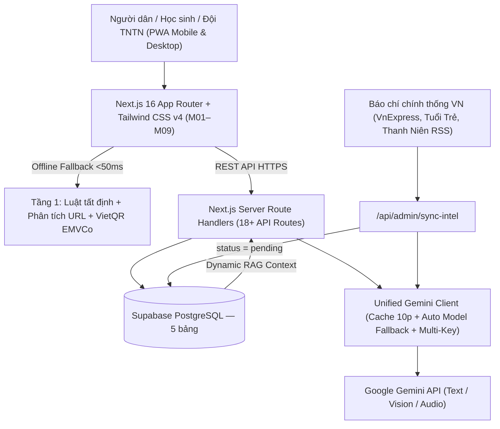
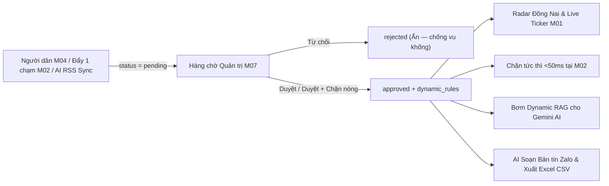

# BÁO CÁO KỸ THUẬT DỰ ÁN — LÁ CHẮN SỐ ĐỒNG NAI

> **Cuộc thi:** Dong Nai Youth Hackathon 2026 — Vòng Chung kết 24h (25–26/11/2026)  
> **Đề tài:** Đề 4 — *Lá Chắn Số (An toàn thông tin – Phòng, chống lừa đảo – Kỹ năng số)*  
> **Đội thi:** **Đội 12 — INFINITY AI**  
> **Thành viên:** Nguyễn Thành Lộc *(Trưởng nhóm)* • Phạm Phúc Hoàng • Nguyễn Hoàng Nhật Nam • Nguyễn Hoàng Minh Dũng  
> **Sản phẩm chạy trực tuyến (Live Demo):** https://la-chan-so-dong-nai.vercel.app  
> **Kho mã nguồn (GitHub):** https://github.com/ChuTichNgheo/la-chan-so-dong-nai  
> **Mở nhanh Chế độ Tối giản (1 chạm):** https://la-chan-so-dong-nai.vercel.app/?mode=minimal

---

## 1. Tóm tắt điều hành & Đối chiếu 100% yêu cầu Đề 4

**Lá Chắn Số Đồng Nai** là nền tảng Web-App / PWA mobile-first truy cập tức thì qua mã QR hoặc liên kết Zalo (không cần cài đặt phức tạp, hoạt động ổn định cả khi mất mạng qua *Offline Fallback*), được xây dựng theo triết lý **Inclusive Design**: *"Tối giản cho người cần thao tác nhanh – Trực quan cho học sinh – Hiệu quả cho Đội Thanh niên tình nguyện (Tổ Công nghệ số cộng đồng)"*.

### Bảng đối chiếu đáp ứng Đề 4

| Hạng mục theo Đề 4 | Trạng thái | Tính năng đã triển khai chạy thật |
| :--- | :---: | :--- |
| **1. Kiểm tra nhanh SĐT, đường dẫn, STK** *(kết quả kèm lý do dễ hiểu)* | **Đạt & Vượt chuẩn** | Quét Hybrid 2 tầng (`M01–M02`): Luật tất định + DB Đồng Nai + Giải mã URL rút gọn + **Dynamic RAG Gemini AI** + Vision đọc ảnh/bill + **Quét & giải mã VietQR EMVCo trực tiếp trước khi chuyển tiền**; hiển thị 4 mức cảnh báo (*Color-Not-Only*), 3 thanh đo **Đòn tâm lý thao túng** và **Câu nói thoát thân an toàn**. |
| **2. Báo cáo trường hợp lừa đảo** | **Đạt & Vượt chuẩn** | Form 3 bước (`M04`) lưu thật vào Supabase trạng thái `pending` (chống vu khống) + **AI tự bóc thông tin từ ảnh bằng chứng** (`/api/reports/autofill`) + nút **Đẩy nhanh 1 chạm** ngay từ `M02`. |
| **3. Nút "Hỏi người thân" gửi nhanh** | **Đạt & Vượt chuẩn** | Lưu người thân tin cậy (`M03`), che SĐT mặc định, gửi cảnh báo **xuyên thiết bị 2 chiều** qua DB (`family_alerts`: *Đã gửi → Đã xác nhận*), gọi `tel:` / SMS / Web Share + **Mật khẩu Gia đình & Kiểm tra Deepfake 3 giây**. |
| **4. Bài học ngắn 01 phút theo tình huống** | **Đạt & Vượt chuẩn** | Đủ **10/10 tình huống lừa đảo phổ biến** (`M05–M06`), gồm 2 video tuyên truyền thật dạng Reels vuốt dọc (có tiếng, phụ đề chữ to) và 10 bài học mở trọn 3 bước (*Chiêu trò → Dấu hiệu → Xử lý*) kèm nút **Nghe đọc 1 phút** & **Quét thử ngay**. |
| **5. Bài kiểm tra nhận diện có chấm điểm** | **Đạt & Vượt chuẩn** | 2 chế độ tại `M06`: **Mini Game Phản xạ 10 giây** (5 màn, 3 lá chắn, tính chuỗi & điểm) và **Đấu trí trực tiếp với Kẻ lừa đảo AI** (chat thật 3 lượt với Gemini nhập vai → chấm **Độ Tỉnh Táo 0–100**, chỉ rõ lỗi sơ hở) + xuất **Thẻ Huy Hiệu PNG** thách đấu gia đình. |
| **6. Màn hình Đội tình nguyện (thống kê địa phương)** | **Đạt & Vượt chuẩn** | Radar Đồng Nai (`M07`): số liệu thật từ Supabase, **Bản đồ Điểm nóng 6 địa bàn Đồng Nai**, biểu đồ xu hướng 7 ngày, hàng chờ duyệt + **Duyệt & Chặn nóng**, **API tự gom tin lừa đảo RSS + Gemini AI**, AI soạn Bản tin Zalo 1 chạm, xuất **Poster QR Dán Tủ Lạnh (.png)** & **Xuất Excel (.csv)**. |
| **Điểm cộng 1: AI phân tích tin nhắn dán vào** | **Đạt & Vượt chuẩn** | Gemini Multimodal phân tích văn bản, ảnh chụp màn hình, bill chuyển khoản, mã QR kết hợp Dynamic RAG tri thức Đồng Nai. |
| **Điểm cộng 2: Chế độ giọng nói cho người cao tuổi** | **Đạt & Vượt chuẩn** | **3 Chế độ Giao diện Thích ứng** (*Tối giản / Tiêu chuẩn / Chuyên sâu*) + **Lá Chắn Nghe Trực Tiếp** (nghe Micro trên cả máy tính lẫn iPhone/Android qua `MediaRecorder + Gemini Audio`) báo động đỏ tức thì & đọc to tiếng Việt 3 tầng. |
| **Điểm cộng 3: Kết nối kênh tiếp nhận Công an** | **Đạt & Vượt chuẩn** | Tự động tạo **Hồ sơ tin báo chuẩn hóa** sao chép 1 chạm + mở trực tiếp kênh **Công an / 113 / VNeID / Cổng NCSC / Tổng đài 111**. |

---

## 2. Bài toán & Bối cảnh thực tế tại tỉnh Đồng Nai

1. **Thực trạng đa dạng thủ đoạn tại địa bàn:** Tội phạm mạng liên tục thay đổi kịch bản từ giả danh Công an TP. Biên Hòa / TP. Long Khánh, gửi link `.xyz`/`.apk` tích hợp BHYT VNeID giả, giả nhân viên Điện lực Đồng Nai dọa cắt điện, đến tuyển CTV việc nhẹ lương cao nhắm vào học sinh THPT tại các khu dân cư đông đúc (P. Trấn Biên, P. Tân Phong, Long Thành, Nhơn Trạch, Trảng Bom). Dữ liệu tham chiếu ghi nhận trung bình **120+ lượt báo cáo/tháng**, trong đó **~35% là đường dẫn giả mạo**.
2. **Khoảng trống tâm lý của nhóm yếu thế:** Theo Cẩm nang *Kết nối không tổn thương* (Cục An ninh mạng / UNICEF), **89%** trẻ em 12–17 tuổi tại Việt Nam dùng Internet nhưng **58,6%** nạn nhân chọn im lặng vì sợ hãi/xấu hổ. Với người lớn tuổi hoặc người ít rành công nghệ, thủ đoạn *"cô lập nạn nhân – gây hoảng loạn – ép chuyển tiền gấp"* khiến họ mất bình tĩnh trước khi kịp hỏi con cháu.
3. **Nút thắt của Đội Thanh niên tình nguyện (Tổ CNSCĐ):** Thiếu một công cụ gọn nhẹ để gom báo cáo theo từng phường/xã, xác minh chống vu khống, tổng hợp số liệu báo cáo tháng và phát nhanh cảnh báo trực quan vào nhóm Zalo khu phố hoặc dán tại hộ gia đình.

---

## 3. Kiến trúc Hệ thống & Chiến lược AI (30 điểm Tiêu chí 2)

### 3.1. Sơ đồ Kiến trúc Tổng thể



### 3.2. Tại sao chọn *Hybrid Rules + Dynamic RAG + Human-in-the-Loop* thay vì Train tĩnh?

Trong bài toán chống lừa đảo, số điện thoại rác, đường link `.xyz` và kịch bản lừa đảo biến đổi theo từng giờ. Nếu chỉ *fine-tune* mô hình tĩnh, dữ liệu sẽ lỗi thời ngay sau khi huấn luyện, tốn chi phí GPU và tiềm ẩn rủi ro ảo giác (*hallucination*). Lá Chắn Số Đồng Nai áp dụng **Kiến trúc 4 lớp chuẩn Production**:

1. **Lớp 1 — Luật Tất Định & Phân Tích Kỹ Thuật (`< 50ms`, 100% Offline, 0% ảo giác):**
   * Đối chiếu tên miền gốc `.gov.vn` (không khớp chuỗi con lỏng lẻo ở path/query tránh bị lừa dạng `vneid.gov.vn.xyz`), tự mở rộng đường link rút gọn (`url-inspector.ts`), phát hiện đuôi `.apk`/`.xyz`/`.top` và giải mã trực tiếp chuẩn **VietQR EMVCo TLV** (`vietqr-parser.ts`) trước khi chuyển tiền.
2. **Lớp 2 — "Học nóng" bằng Dynamic RAG từ Supabase (Cập nhật theo giây, không cần Re-train):**
   * Khi gọi `POST /api/analyze`, server tự động nạp các **luật chặn nóng (`dynamic_rules`)** và **báo cáo đã duyệt mới nhất tại Đồng Nai (`scam_reports`)** vào ngữ cảnh gửi cho Gemini. Chỉ cần Quản trị viên Đội TNTN duyệt 1 thủ đoạn mới tại Biên Hòa, **ngay giây tiếp theo AI đã nhận diện được các biến thể của thủ đoạn đó trên toàn tỉnh**.
3. **Lớp 3 — Unified Gemini Client chống sập & chống quá tải (`src/lib/gemini-client.ts`):**
   * **Response Cache (TTL 10 phút):** Nhiều người dùng quét cùng 1 tin đồn/link viral chỉ gọi AI 1 lần, các lượt sau trả `< 10ms`.
   * **Auto Model Fallback & Multi-Key Rotation:** Tự động chuyển chuỗi model (`gemini-2.5-flash` → `gemini-2.0-flash` → `gemini-3-flash-preview`) và xoay vòng `GEMINI_API_KEYS` khi gặp 429/503; nếu mất mạng hoàn toàn thì hạ tầng mượt mà về Lớp 1.
4. **Lớp 4 — Guardrail An Toàn (Anti-False-Negative & Human-in-the-Loop):**
   * Server khóa cứng quy tắc: AI **tuyệt đối không được hạ mức `Nguy hiểm`** của Lớp 1/DB xuống `An toàn`, và **không bao giờ gắn nhãn "100% an toàn"** cho số lạ chưa có dữ liệu.
   * Linh vật **Cún AI** hỗ trợ dẫn đường nhưng luôn dừng lại trước nút xác nhận cuối để con người tự ra quyết định.

---

## 4. Thiết kế Cơ sở Dữ liệu (5 bảng Supabase PostgreSQL — Khép kín)

Toàn bộ dữ liệu lưu trên **Supabase PostgreSQL** (schema tại [schema.sql](file:///d:/Projects/hackathon/la-chan-so-dong-nai/supabase/schema.sql)), kết nối hoàn toàn từ phía server (`src/lib/db.ts`) để bảo vệ `SUPABASE_SERVICE_ROLE_KEY`:

| Bảng | Vai trò nghiệp vụ | Cột trọng yếu |
| :--- | :--- | :--- |
| **`app_users`** | Tài khoản Người dân & Quản trị Đội TNTN | `id`, `username`, `password_hash` (`scrypt`), `role` (`user`/`admin`), `is_locked`, `trusted_name`, `trusted_phone`, `game_score`, `game_badge` |
| **`scam_reports`** | Trung tâm báo cáo cộng đồng & tin AI gom từ RSS | `id`, `type`, `target`, `target_masked`, `area`, `description`, `status` (`pending`/`approved`/`rejected`), `reporter_id`, `created_at` |
| **`dynamic_rules`** | Luật chặn nóng ưu tiên cao nhất do Đội TNTN quản lý | `id`, `pattern`, `level` (`danger`/`warn`/`safe`), `note`, `created_by`, `created_at` |
| **`scan_history`** | Nhật ký kiểm tra cá nhân của tài khoản đã đăng nhập | `id`, `user_id`, `snippet`, `risk_level`, `title`, `created_at` |
| **`family_alerts`** | Cảnh báo gia đình xuyên thiết bị 2 chiều (`M03`) | `id`, `sender_name`, `target_phone`, `risk_level`, `snippet`, `status` (`sent`/`acknowledged`), `acknowledged_by` |

### Vòng đời dữ liệu khép kín sau khi Quản trị viên duyệt


---

## 5. Điểm Sáng tạo & Khác biệt Nổi bật (20 điểm Tiêu chí 3)

1. **Giao diện Thích ứng 3 cấp độ không phân biệt độ tuổi (*Inclusive Design*):** Thay vì dán nhãn cứng "65+", người dùng tự chọn **Tối giản** *(chữ to, 1 chạm)* • **Tiêu chuẩn** • **Chuyên sâu** *(kỹ thuật URL, nguồn Hybrid/RAG)* tùy theo thói quen công nghệ hoặc trạng thái tâm lý.
2. **Lá Chắn Nghe Trực Tiếp xuyên thiết bị (`LiveVoiceGuardModal` + `/api/transcribe`):** Nghe trực tiếp lời nói/loa ngoài cuộc gọi lạ, bắt từ khóa lừa đảo tức thì và đọc to cảnh báo khẩn; tự động dùng **`MediaRecorder` + Gemini Multimodal Audio** trên iPhone/Android để khắc phục triệt để hạn chế của `Web SpeechRecognition` trên di động.
3. **Quét & Giải mã VietQR EMVCo trực tiếp trước khi chuyển tiền (`vietqr-parser.ts`):** Bóc tách ngay **Tên ngân hàng (theo mã BIN Việt Nam), Số tài khoản, Số tiền, Nội dung** ẩn trong mã QR rồi đối chiếu lừa đảo trước khi người dân mở app ngân hàng.
4. **Mật khẩu Gia đình & Chống Deepfake 3 giây (`M03`):** Lưu **Câu hỏi & Đáp án bí mật** hoàn toàn cục bộ trên thiết bị (không gửi lên server) kết hợp 3 bước kiểm chứng video call AI giả mặt/giả giọng.
5. **Phân tích 3 Đòn Tâm Lý & Câu Thoát Thân Mẫu (`M02`):** Minh họa trực quan mức độ *Gây hoảng loạn / Ép chuyển gấp / Cô lập* và cấp sẵn câu từ chối lịch sự, dứt khoát (có nút đọc to/copy) giúp người yếu thế giữ bình tĩnh cúp máy.
6. **Đấu trí trực tiếp với Kẻ lừa đảo AI (`M06`):** Gemini nhập vai kẻ gian phản hồi 3 lượt theo câu người chơi tự gõ, gợi ý trả lời động từng lượt, chấm điểm **Độ Tỉnh Táo (0–100)**, chỉ lỗi sơ hở và xuất **Thẻ Huy Hiệu PNG** lan tỏa trong gia đình.
7. **Bộ công cụ thực chiến cho Tổ CNSCĐ Đồng Nai (`M07`):** Tự động gom tin báo chí RSS+AI về hàng chờ duyệt, **Bản đồ Điểm nóng 6 địa bàn**, biểu đồ 7 ngày, AI soạn Bản tin Zalo 1 chạm, **Poster QR Dán Tủ Lạnh (.png)** mở thẳng `/?mode=minimal`, và **Xuất báo cáo Excel (`.csv` UTF-8 BOM)**.

---

## 6. Bảo mật, Quyền riêng tư & An toàn Hệ thống

* **Privacy-by-Design:** Tự động che SĐT/STK dạng `0912 *** 678` qua `src/lib/privacy.ts` ở cả phía Server lẫn Client; **Mật khẩu Gia đình** chỉ lưu trên thiết bị người dùng (`localStorage`), không truyền qua mạng.
* **Xác thực & Phân quyền chuẩn:** Băm mật khẩu bằng `crypto.scryptSync` kèm salt ngẫu nhiên và phiên đăng nhập lưu trong **HttpOnly, SameSite=Lax Cookie** (`src/lib/auth.ts`). Tách biệt hoàn toàn quyền `user` (gửi báo cáo) và `admin` (xem hàng chờ, duyệt/từ chối, đồng bộ RSS+AI, quản lý luật chặn nóng, khóa tài khoản spam).
* **Bảo vệ khóa API:** Toàn bộ `GEMINI_API_KEY` và `SUPABASE_SERVICE_ROLE_KEY` chỉ nằm trong biến môi trường server, tuyệt đối không lộ xuống mã nguồn trình duyệt.
* **WCAG 2.2 AA & Color-Not-Only:** Bảng màu Emerald Trust độ tương phản cao, 4 mức cảnh báo phân biệt đồng thời bằng màu sắc, biểu tượng và nhãn chữ rõ ràng.

---

## 7. Kê khai Công nghệ, Mã nguồn mở, Công cụ AI & Giấy phép *(Tuân thủ Mục IX Thể lệ)*

| Hạng mục | Tên công nghệ / Thư viện / Dịch vụ | Phiên bản / Vai trò | Giấy phép / Điều khoản |
| :--- | :--- | :--- | :--- |
| **Framework Web** | Next.js (App Router, Turbopack) | `16.4.6` — Frontend & Backend API Routes | MIT License |
| **Thư viện UI** | React & React DOM | `19.3.0` — Giao diện phản hồi tức thì | MIT License |
| **Ngôn ngữ** | TypeScript | `^5` — Kiểm soát kiểu dữ liệu chặt chẽ | Apache-2.0 License |
| **Styling** | Tailwind CSS | `4.3.3` — Responsive Mobile-first & Adaptive UI | MIT License |
| **Biểu tượng** | Lucide React | `^1.79.0` — Bộ icon chuẩn WCAG | ISC License |
| **Cơ sở dữ liệu** | Supabase (`@supabase/supabase-js`) | `^2.119.2` — PostgreSQL Cloud Database | MIT / Apache-2.0 |
| **AI Đa phương thức** | Google Gemini API (`gemini-2.5-flash` / `2.0-flash` / `3-flash-preview`) | Phân tích văn bản, Vision đọc ảnh/bill/QR, Audio chép lời mobile, Roleplay, Soạn tin Zalo, Chuẩn hóa RSS | Google Gemini API Terms of Service |
| **Hosting / Deploy** | Vercel | Triển khai HTTPS Production & Serverless Functions | Vercel Terms of Service |
| **Web APIs chuẩn** | Web Speech API, MediaRecorder API, BarcodeDetector API, HTML5 Canvas, Web Share API | Giọng nói tiếng Việt, ghi âm mobile, quét QR camera, xuất thẻ PNG/Poster, chia sẻ Zalo | Chuẩn mở W3C / WHATWG |
| **Tạo mã QR ảnh** | `api.qrserver.com` *(có fallback vẽ ma trận nội bộ khi offline)* | Tạo mã QR thực quét mở thẳng `/?mode=minimal` trên Poster tủ lạnh | Public Free API |
| **Nguồn tin RSS** | VnExpress, Tuổi Trẻ, Thanh Niên *(RSS công khai)* | Thu thập tiêu đề cảnh báo lừa đảo chính thống đưa về Admin duyệt | RSS công khai có ghi rõ nguồn báo |
| **Công cụ hỗ trợ code** | Google Antigravity AI Coding Assistant | Hỗ trợ tái cấu trúc, kiểm thử tự động, rà soát bảo mật & tối ưu giao diện trong thời gian thi | Tuân thủ Mục IX Thể lệ cuộc thi |

---

## 8. Tính khả thi, Chi phí vận hành & Lộ trình phát triển (25 điểm Tiêu chí 4)

### 8.1. Chi phí vận hành tối ưu cho Thành đoàn & Địa phương
* **Giai đoạn triển khai thí điểm (phường/xã & trường THPT tại Đồng Nai):** Gần như **0 đồng/tháng** nhờ kiến trúc Hybrid chặn ~80% lượt đơn giản ở Lớp 1/DB + Server Cache 10 phút, chạy vừa gọn trong gói Free Tier của Vercel, Supabase và Gemini API.
* **Triển khai tức thì không rào cản:** Đoàn viên chỉ cần in **Poster QR Dán Tủ Lạnh** từ ngay màn hình `M07` dán tại nhà văn hóa khu phố, bảng tin trường THPT và hộ gia đình người cao tuổi.

### 8.2. Lộ trình mở rộng (3 giai đoạn)
* **Giai đoạn 1 (Hiện tại — 11/2026):** Hoàn thiện MVP chạy thật toàn diện, thí điểm tại P. Trấn Biên, P. Tân Phong và 2–3 trường THPT trên địa bàn TP. Biên Hòa.
* **Giai đoạn 2 (Q1–Q2/2027):** Tích hợp **Zalo Mini App** & **Zalo OA Thành đoàn Đồng Nai** để gửi thông báo đẩy (*Push Alert*) trực tiếp tới người dân; bổ sung **pgvector (Vector Search)** trên Supabase để phát hiện biến thể kịch bản theo ngữ nghĩa.
* **Giai đoạn 3 (Cuối 2027):** Kết nối chuẩn hóa API chia sẻ dữ liệu với **Cổng cảnh báo an toàn thông tin (NCSC)** & **Công an tỉnh Đồng Nai**; huấn luyện (LoRA/Fine-tune) mô hình phân loại nhẹ tiếng Việt từ tập dữ liệu ẩn danh đã được xác minh để tự chủ hạ tầng và giảm chi phí ở quy mô hàng trăm nghìn người dùng.

---

## 9. Hướng dẫn trải nghiệm nhanh cho Ban Giám Khảo

1. **Truy cập bản Live:** https://la-chan-so-dong-nai.vercel.app *(hoặc bản Tối giản 1 chạm: `/?mode=minimal`)*.
2. **Tài khoản Demo đã tạo sẵn trên Supabase:**
   * **Người dân:** `nguoidan` / `123456`
   * **Quản trị Đội TNTN (Admin):** `doantn` / `admin123` *(đăng nhập tại mục **Cài đặt** góc phải trên cùng, sau đó vào tab **Radar** để trải nghiệm nút **Quét & Đồng bộ RSS+AI**, **Duyệt + Chặn nóng**, **Luật chặn nóng** và **Quản lý người dùng**)*.
3. **Chạy cục bộ (Local Development):**
   ```bash
   cd la-chan-so-dong-nai
   npm install
   # Điền GEMINI_API_KEY, SUPABASE_URL, SUPABASE_SERVICE_ROLE_KEY vào .env.local
   # Chạy supabase/schema.sql trên Supabase SQL Editor
   npm run dev
   ```
